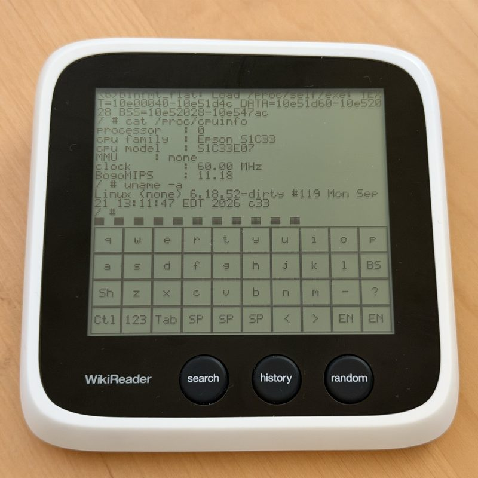
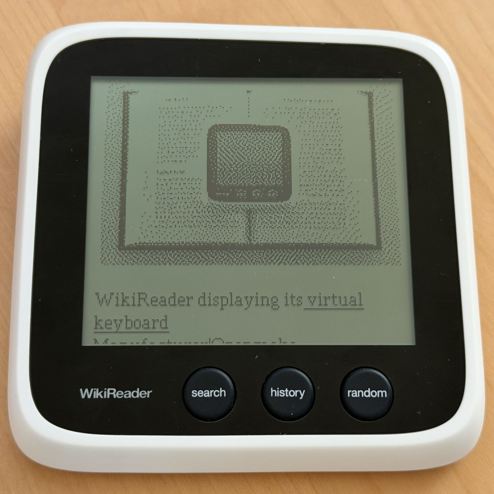
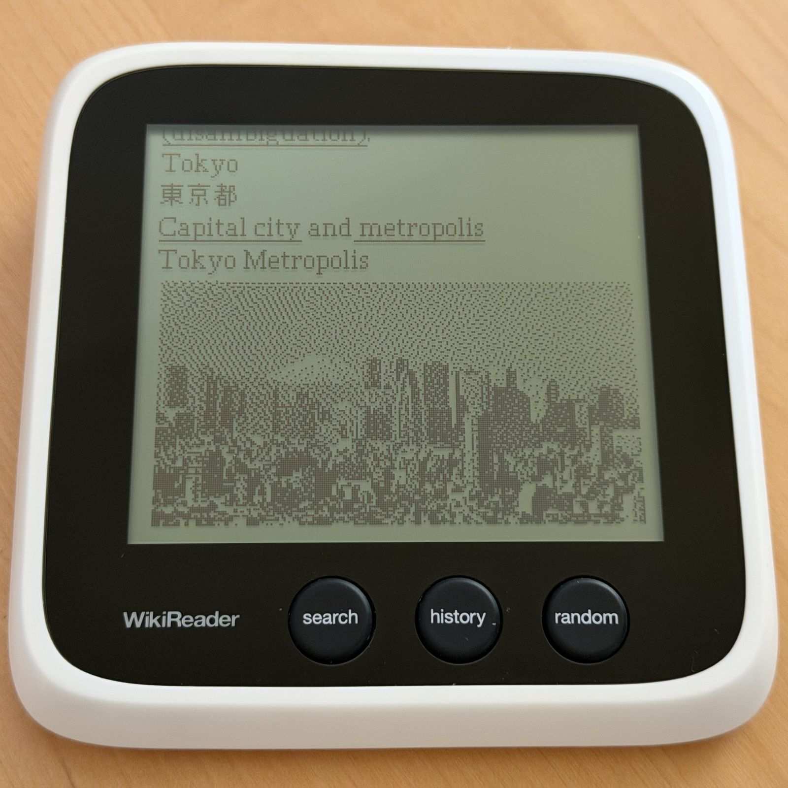
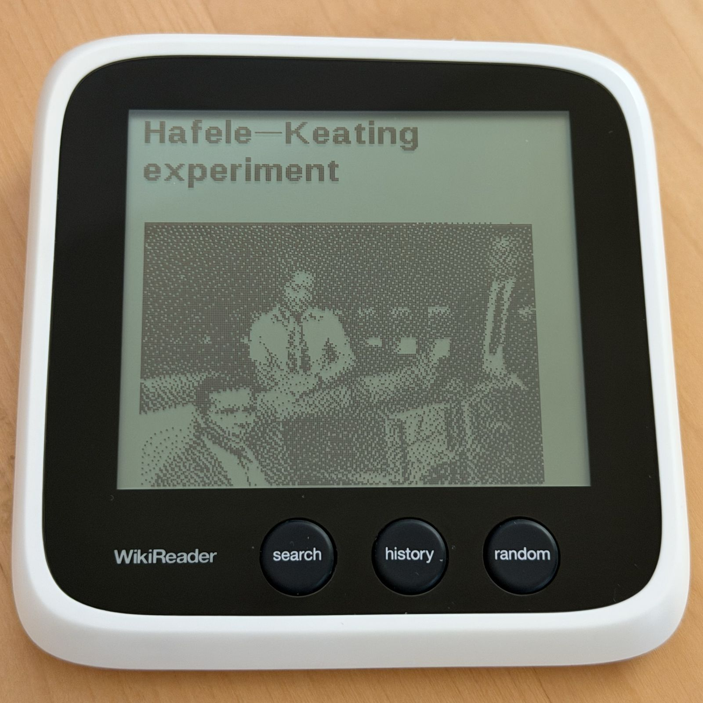

# WikiReader









This repository holds firmware and tools for the WikiReader, a handheld built
around the Epson S1C33E07 (a 60 MHz C33 CPU with 16 or 32 MiB of SDRAM). It
is a fork of [stephen-mw/wikireader](https://github.com/stephen-mw/wikireader).

We added a current GCC and binutils, a full-system emulator, a reader for
Kiwix ZIM archives, and three operating systems: NuttX, Linux, and a RISC-V
machine that boots Linux. We also ported Doom, a Macintosh Plus, a Game Boy
and Llama 2, and dumped the chip's boot ROM. All of them start from the normal
launcher. The original pipeline that turns a
Wikipedia dump into a WikiReader image still works, unchanged.

## How the device boots

The chip's mask ROM loads a small boot program from the serial FLASH. That
program loads Grifo, the WikiReader's kernel, from `kernel.elf` on the SD
card. Grifo starts `init.app`, the icon launcher, and `init.ini` lists the
applications on its screen. Every program in this repository starts this way,
on the device and in the emulator.

## What's here

### Toolchain

- `host-tools/toolchain-c33`: binutils 2.47 and GCC 16.2 for the C33. There
  are two targets. `c33-epson-elf-` builds the firmware and applications.
  `c33-linux-musl-` builds C and C++ programs for Linux, as FDPIC ELF with
  shared libraries. The binutils test suites pass with no unexpected failures
  on both targets. GCC's execute torture suite runs inside Linux in the
  emulator: 24,353 tests pass and one fails. We kept the original binutils
  2.10.1 and GCC 3.3.2 build so that we can check the ABI and assembler output
  against it.

### Emulator

- `emulator`: `wremu`, a full-system emulator. It boots the whole chain above
  from a FLASH image and a card image, and it runs headless or in an SDL2
  window. We measured the device's memory timing, SPI and DMA behaviour, and
  the CPU's fetch rules on real hardware, and fitted the emulator's timing
  model to those measurements. For ZIM article loads and the RISC-V
  benchmark, the emulator's times are within 3% of the device's. The
  emulator's README lists where the model is still off.

### Reading Wikipedia

- `zim`: `zim.app` reads ZIM archives, the format Kiwix uses. It handles a
  full English Wikipedia (124 GB) as well as smaller archives, and you can
  keep several archives on one card and pick one from a list. It has prefix
  search, links between articles, links within a page, history, and inline
  photographs. It decodes Zstandard and WebP on the C33 itself and dithers
  photos to one bit. It draws an article's text first and fills in images
  after. On a real device, Simple English Wikipedia shows the first page of
  the Cat article 0.87 s after the tap. The card has two partitions: FAT32
  for the boot files and exFAT for the archives, so an archive can be larger
  than 4 GiB.
- `wiki`: the original reader for the WikiReader's own format, with fixes.
- `sparrow`: answers short factual questions offline from Wikidata, then
  opens the matching article in `zim.app`. It works, but we have only
  measured it on a sample of the data; see `sparrow/STATUS.md`.

### Kernel and libraries

- `samo-lib`: Grifo, FatFs R0.16, mini-libc, the drivers, and the MBR boot
  program. SD reads use 32-bit DMA, and FatFs reads runs of adjacent clusters
  in one request.
- `samo-lib/forth`: the WikiReader's own Forth. Its source is in Forth, and
  the Forth can compile that source itself. `bootstrap.py` runs it in the
  emulator through Grifo and gets the same bytes that gforth writes, so you
  can build the Forth without gforth.

### Operating systems

- `linux`: Linux 7.3 without an MMU, running natively on the C33. It starts
  from the launcher like any other application, and `reboot` returns to the
  launcher. One kernel image runs on both 16 MiB and 32 MiB boards. The board
  is described in a device tree, with schemas for every binding. Each piece of
  hardware has a standard Linux driver:
  - the LCD as a DRM device, with `/dev/fb0` on top of it
  - the touchscreen through serdev, and the buttons and power switch through
    `gpio-keys`
  - the SD card through a dedicated host driver with DMA reads
  - pins and GPIOs through pinctrl, clocks through the common clock framework,
    and the timers as a clocksource with high-resolution timers
  - a PWM for the contrast, IIO for the battery voltage and temperature, and
    the watchdog

  Buildroot 2026.08.1 builds the root filesystem, a 24 MB ext4 image that
  lives as one file on the card's FAT partition. All programs share one copy
  of BusyBox and of musl in memory. On screen, Linux shows a terminal
  with a touch keyboard. `startx` starts X11 (Xfbdev, twm, xterm and xeyes),
  which you control by touch. Suspend works, and a touch wakes the device. On
  the device, the shell prompt appears 4.76 s after the kernel starts. C++ works,
  with exceptions and threads. 1,183 of LTP's POSIX tests pass. A Wayland
  session (cage and foot) also builds, but it is switched off because X is
  much cheaper on this CPU.
- `nuttx`: Apache NuttX. You get NSH with 139 Toybox commands (`awk grep sed
  find sort xargs tar` and more), `vi`, a hex editor, and ZMODEM file
  transfer. Five languages run on the device: Lua, MicroPython, BASIC, the
  WikiReader's own Forth, and C through TinyCC. TinyCC compiles C33 code on
  the device and can compile itself. NuttX has its own SPI and SD drivers and mounts the
  boot partition at `/sd`. Once it starts, it runs the machine until
  `poweroff` or `reboot`.
- `riscv`: `riscv.app`, an rv32ima machine that boots a no-MMU RISC-V Linux
  with a terminal and touch keyboard. It can interpret RISC-V code or
  translate it to C33 code as it runs. On the device, the interpreter takes
  72.7 cycles per RISC-V instruction and the translator 13.2. The guest
  kernel is downloaded, not built here.

### Emulators and games

- `doom`: `doom.app`, the original Doom in black and white, with touch and
  button controls. The first level runs at 14.7 frames a second on the
  device. The engine source lives in the repository at a fixed revision.
- `minivmac`: `minivmac.app`, a 4 MiB Macintosh Plus without sound. It boots
  System 7.1 to the Finder. A translator turns hot 68000 code into C33 code,
  and Mini vMac runs everything else. The screen shows a 240x160 window onto
  the Mac's 512x342 display and scrolls when the pointer reaches an edge.
  Touch moves the mouse. You need to supply the ROM and floppy images.
- `gameboy`: `gameboy.app`, a Game Boy (DMG) emulator based on Peanut-GB,
  without sound. We rewrote the CPU, timing and drawing code for the C33. In
  the emulator, games run at 145% to 224% of full speed, Link's Awakening
  included. It has not yet been timed on a device. It lists the `.gb` files
  on the card and keeps battery saves.

### Machine learning

- `llama`: `llama.app` runs Llama 2 models from `tinyllamas`. `stories260K`
  writes TinyStories text at 119 ms a token. The weights are int8, and the
  forward pass has no floating point at all. That change made it about ten
  times faster. A host script converts the checkpoints.

### Hardware research

- `romdump`: `romdump.app` copies the boot FLASH and the chip's 64 KB boot
  ROM to the card. We dumped three devices, and all three boot ROMs match.
  Most of the ROM is an MP3 decoder that Epson's manuals do not mention.
  `romdump/BOOTROM.md` describes the boot code and the decoder. The top
  16 KB of the ROM reads back as zeros by every method we tried.
- `mp3rom`: `mp3rom.app` calls the ROM's MP3 decoder on test files and saves
  its output, so that we could measure what it does.

Each directory has its own README with the details.

## Building

First build the toolchain. This downloads binutils and GCC, builds them, and
takes about ten minutes:

```sh
host-tools/toolchain-c33/binutils/build.sh host-tools/toolchain-c33/work
host-tools/toolchain-c33/gcc/rebuild.sh
```

It installs under `host-tools/toolchain-c33/work/install/`. The other
Makefiles look there by default. Then, from the repository root:

```sh
make wiki zim doom
```

This builds the three applications, along with mini-libc, the drivers, FatFs
and Grifo.

Other applications have their own targets:

- `make minivmac` and `make gameboy` download the upstream emulator source at
  a fixed revision on the first build. `minivmac/README.md` lists the ROM and
  disk files you need on the card.
- `make nuttx` downloads NuttX, nuttx-apps and TinyCC at fixed revisions on
  the first run (about 340 MB) and applies this repository's port on top. It
  also needs GNU `make` and `flock`. See `nuttx/README.md`.
- `make -C riscv`, `make -C llama`, `make -C romdump` and `make -C mp3rom`
  build those applications. Run `riscv/fetch-linux.sh` once to download the
  RISC-V guest kernel and device trees.

Linux builds in an ARM64 Debian VM under Lima, since the kernel build and
Buildroot need a Linux host:

```sh
make -C linux provision    # once: create the VM and install what it needs
make -C linux toolchain    # once: build the Linux C33 toolchain in the VM
make -C linux build        # kernel, root filesystem and linux.app
make -C linux boot-test    # boot it through Grifo and check the console,
                           # card, panel and touch input
```

`linux/README.md` covers the other tests: `x11-test`, `dt-check`,
`ltp-test`, `gcc-test` and `binutils-test`.

Each component has a `<component>-clean` target. Extra compiler flags go in
`OPT`. The build adds them after `-Werror`, and the default is `-O2`. Git
ignores all build output.

You can still build the original EPSON binutils 2.10.1 / GCC 3.3.2 toolchain
with `make toolchain`. Nothing depends on it. To build with it, set
`TOOLCHAIN_BIN` to `host-tools/toolchain-install/bin`.

## Emulator

```sh
make -C emulator
make -C emulator check
```

You don't need the cross-compiler to build the emulator, because the decode
tables are checked in. You need SDL2 only for the window (`brew install
sdl2`). `check` runs on a fresh checkout. A few tests need a local card image
or objdump output; when those are missing, the tests skip themselves and
print why.

To run firmware you need two things that are not in the repository: a kernel
that you have built, and a card image. `emulator/README.md` explains how to
get both, and also covers the boot chain and profiling. Then:

```sh
cd emulator
make -C .. mbr   # once: samo-lib/mbr/flash.rom, which make-flash.py patches
rm -f /tmp/flash.rom && python3 ../samo-lib/mbr/make-flash.py /tmp/flash.rom
./wremu -e /tmp/flash.rom -c images/wrcard.img
```

This boots the same way the device does: mask ROM, the boot program in FLASH,
Grifo from the card, `init.app`, then whatever application `init.ini` names.
Always boot this way. If you load an application or kernel directly, it runs
at the wrong clock speed and skips the hardware setup that Grifo does, so its
behaviour and timing do not match the device. `wremu` only accepts a bare ELF
with `--bare-elf`, which exists for the compiler test suites.

Useful options: `-R` resets and runs headless, `-n` limits the number of
cycles, `-s` traces system calls, and `-K`, `-T` and `-N` send scripted keys,
taps and button presses.

## SD cards

`zim/make-card-image` (macOS) writes a card with two partitions: FAT32 for the
boot files and exFAT for the archives. `zim/README.md` describes the layout
and the launcher. `--doom WAD` and `--gameboy ROM` add Doom and the Game Boy
with their game data, `--nuttx` adds NuttX, and `--linux` adds native Linux
with its system image, the card's `bin` folder and the test programs its `t`
runs (`linux/card/tests.list`).

`card-test.py IMAGE` runs every launcher entry of a card image in wremu the
way the device is used: each on its own copy of the image, booted through
Grifo, its icon tapped, then driven on the panel (an article opened in the
reader, a game started, `t` and `check` typed into Linux's console and their
reports read back off the card). It fails on a missing ready line, a failed
check or any kernel fault, and leaves the final screens in one contact sheet.

`install-card.sh` updates NuttX and Linux on an existing card. Mount the boot
partition, and the script copies the built applications, icons, `linux.img`
(in place, so it keeps its clusters), the card's `bin` folder and the test
programs over, adds any missing lines to `init.ini`, then remounts the card
and checks every file again.

## Classic image build

The original pipeline converts a Wikimedia dump into the WikiReader's own
format. It runs in Docker:

```sh
docker pull stephenmw/wikireader
docker run --rm -v $(pwd)/build:/build -ti \
    docker.io/stephenmw/wikireader:latest autowiki 20200601
```

The result goes to `build/<date>/image`; copy it to a FAT32 card. The build
needs about 16 GB of RAM and takes a little over 12 hours.
[doc/image-build.text](doc/image-build.text) has the manual steps, a command
to clean the dump, and instructions for building on several machines.

`zim.app` does not use any of this. It reads ZIM archives directly.

## Notes

The Epson S1C33 manuals are not in this repository. You can get them from
Epson and from the Internet Archive. `host-tools/toolchain-c33/gcc/ABI.md`
lists which manuals you need and what each one covers. The board schematics
are in `Circuits/`.

The older notes in `doc/` describe the old 3.3.2 toolchain. They include a
workaround for 32-bit hosts that the current toolchain does not need.
